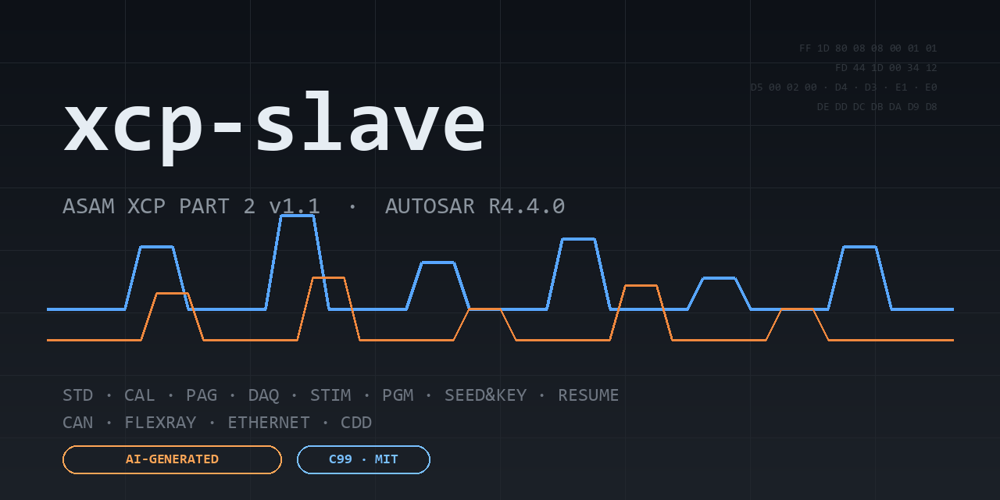

# XCP Slave Stack
> **中文**: [README.zh-CN.md](README.zh-CN.md)



An independent, portable implementation of the **ASAM XCP Part 2 v1.1** slave (target device) protocol,
organized as an AUTOSAR Classic Platform BSW module (R4.4.0 API surface).

Single-channel, C99, no external dependencies beyond your integration hooks.

[](https://github.com/wuwuzhazha/autosar-xcp-slave/releases)
[](https://github.com/wuwuzhazha/autosar-xcp-slave/actions)
[](LICENSE)

---

> ## ⚠️ Origin & Disclaimer
>
> This repository is an **experiment in autonomous AI code generation**. Every line of the
> implementation, configuration generator, test harness, and documentation was produced
> by an autonomous LLM agent driven only by:
> - the public ASAM XCP Part 2 specification text,
> - the AUTOSAR XCP R4.4.0 module requirements,
> - an iterative self-test loop (write → build → run asserts → fix → repeat),
>
> with **no human-written reference code** copied or translated. The goal was to
> measure how far an AI can carry a non-trivial protocol-stack implementation on its own.
>
> **Use at your own risk.** Although the code builds cleanly, passes ~3 000 host-side
> asserts across 10 profiles plus a 103-variant feature matrix, and adheres to the
> documented protocol surface, it has **not** been peer-reviewed by XCP/AUTOSAR
> domain experts, has **not** been validated on real hardware against a commercial
> master (CANape, INCA, etc.), and makes no claim of ASAM conformance, AUTOSAR
> conformance, MISRA-C conformance, or fitness for any particular purpose. For any
> production, safety-related, or customer-facing use you MUST conduct your own
> conformance, robustness, and integration review before shipping.
>
> Reports of incorrect behavior, spec misreads, or missing features are welcome via
> the issue tracker.
>
> **Copyright / IP takedown.** Because the code was produced by an AI without human
> authorship review, it is possible — though not intended — that some portion
> inadvertently resembles copyrighted material (AUTOSAR / ASAM proprietary texts,
> vendor code, or another OSS project). If you believe any content infringes your
> rights, please open an issue or contact the maintainer. The offending files will
> be removed promptly, or the repository taken private/deleted on request.

---

## Features

- **Standard commands** — CONNECT / DISCONNECT / GET_STATUS / SYNCH / GET_COMM_MODE_INFO /
  GET_ID / SET_REQUEST / SET_MTA / UPLOAD / SHORT_UPLOAD / BUILD_CHECKSUM /
  TRANSPORT_LAYER_CMD / USER_CMD
- **Calibration access** — DOWNLOAD / DOWNLOAD_NEXT / DOWNLOAD_MAX / SHORT_DOWNLOAD /
  MODIFY_BITS with `ext`-aware address translation (segment + active page)
- **Calibration pages (CAL/PAG)** — SET_CAL_PAGE / GET_CAL_PAGE / GET_PAG_PROCESSOR_INFO /
  GET_SEGMENT_INFO (modes 0/1/2) / GET_PAGE_INFO / SET_SEGMENT_MODE / GET_SEGMENT_MODE /
  COPY_CAL_PAGE
- **DAQ / STIM** — dynamic + predefined (static) lists, absolute & relative PID field,
  per-ODT timestamps, prescaler, resume on power-up via NvM, event-channel scheduling
- **Flash programming (PGM)** — PROGRAM_START / CLEAR / PROGRAM / PROGRAM_NEXT /
  PROGRAM_MAX / PROGRAM_PREPARE / FORMAT / VERIFY / RESET with sector-range checks and
  `PROGRAM_PREPARE` size accounting
- **Seed & Key protection** — per-resource GET_SEED/UNLOCK with multi-frame seed continuation
  (mode=1), wrong-key disconnect
- **RESUME mode** — DAQ config persist to NvM, auto-restore on init, EV_RESUME_MODE
- **Transport layers** — CAN, FlexRay, Ethernet (SoAd), generic CDD; single `Xcp_LinkType`
  switch selects one
- **Blocking + interleaved** — master block download (`DOWNLOAD_NEXT`) and slave
  block upload (`UPLOAD`), plus an interleaved command queue

## Transport link

One of `XCP_LINK_CAN | XCP_LINK_FLEXRAY | XCP_LINK_ETHERNET | XCP_LINK_CDD` must be active;
the generated `Xcp_Cfg.h` enforces this at compile time (`#error` on zero/multiple).

## Layout

```
Xcp/                    Protocol core (single TU per concern)
  Xcp.c                 Entry: Init/MainFunction/Rx/Tx
  Xcp_Cmd.c             Command dispatch table
  Xcp_Std.c             STD/CAL commands
  Xcp_Daq*.c            DAQ/STIM: cfg, runtime, stim receive
  Xcp_CalPage.c         CAL/PAG
  Xcp_SeedKey.c         Seed & Key
  Xcp_Resume.c          RESUME + NvM persistence
  Xcp_FlashProg.c       PGM
  XcpOn{Can,Fr,Eth,Cdd}.c   Transport layer wrappers
Config/                 xcp_base.toml + profiles/*.toml (extends)
Tools/xcpgen/           xcpgen.py (config generator), xcpserve.py (web UI)
Gen/<profile>/          Generated Xcp_Cfg.h/.c, Xcp_MemMap.h, Xcp_IfData.a2l
Tests/                  Host harness, matrix builds, ratchet
```

## Configuration

Config is **generated** — never edit `Gen/` by hand.

```bash
# Inspect effective config
python Tools/xcpgen/xcpgen.py --config Config/xcp_base.toml --show

# Generate for a profile
python Tools/xcpgen/xcpgen.py --profile can --out Gen/can

# List profiles
python Tools/xcpgen/xcpgen.py --list-profiles
```

A profile is a small TOML that `extends` the base file and overrides keys; see
`Config/profiles/*.toml`.

## Quick start (host build)

```bat
:: Windows — full test sweep (10 profile regen + ratchet + 6 functional variants
:: + predefined DAQ variant + xcpgen tests + 103-variant matrix)
Tests\run_all_tests.bat
```

```bash
# Linux/macOS — same sweep via the matrix runner (requires python3 + gcc)
python3 Tests/build_matrix.py
```

Minimal bring-up on a CAN link:

```c
#include "Xcp.h"

int main(void)
{
    Xcp_Init(&xcp_config);          /* generated const config */

    for (;;) {
        /* your CAN driver calls Xcp_CanIfRxIndication(...) on RX interrupt */
        Xcp_MainFunction();          /* call every XCP_MAIN_FUNCTION_PERIOD_MS */
    }
}
```

The transport hooks (`CanIf_Transmit`, `FrIf_Transmit`, `SoAd_IfTransmit`, or your CDD
name) are the only functions you must supply — see `Xcp/Xcp_Callback.h` for the full
callout contract.

## Tests

Host-side:

- `Tests/test_main.c` — ~317 asserts/variant covering every implemented command +
  error paths (built per functional variant)
- `Tests/test_matrix_func.c` — feature-adaptive smoke (103 profile/feature combos)
- `Tests/test_predef.c` — predefined/static DAQ list coverage
- `Tests/test_xcpgen.py` — config generator unit tests
- `Tests/ratchet.py` — architecture ratchet (forbids regressions on global-symbol
  use, preprocessor complexity, generated-file drift)

End-to-end, with pyxcp over a `python-can` virtual bus:

- `Tests/integration/test_pyxcp_master.py` — connection/memory/DAQ smoke test
- `Tests/integration/test_pyxcp_functional.py` — full command surface, protection
  matrix and negative paths
- `Tests/integration/test_pyxcp_variants.py` — feature-gated profiles and CAN-FD
  wire limits
- `Tests/integration/test_pyxcp_perf.py` — latency/throughput envelope
- `Tests/quality.sh` — clang, ASan/UBSan, coverage, ARM cross-compile and
  cppcheck gates (run by CI's `quality` job)

See [docs/testing.md](docs/testing.md) for the test layers and coverage, and
[docs/performance.md](docs/performance.md) for the benchmark method and reference
numbers. CI is the authoritative pass/fail source: the badge above runs the host
matrix plus all pyxcp suites on Linux and Windows.

## Porting / integration

See [`docs/porting.md`](docs/porting.md) for the integrator checklist:
memory-protection callouts, DTO queue, transport send, timing, NvM hooks, EcuReset
semantics, per-resource seed/key callouts.

## Spec coverage

Feature matrix: [`docs/feature-matrix.md`](docs/feature-matrix.md).
Status mirrors `Docs/FeatureList.md` (Chinese working notes) — public docs are in
`docs/`.

## Disclaimer

This is an **independent implementation** of the published ASAM XCP Part 2 v1.1
protocol. It is not affiliated with, endorsed by, or licensed from AUTOSAR or ASAM.
AUTOSAR specification documents are *not* included and are not distributed with this
project.

## License

MIT — see [`LICENSE`](LICENSE).
