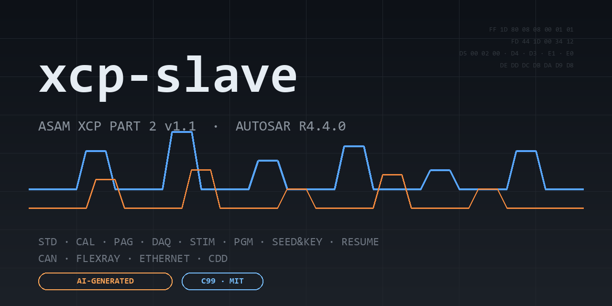

> **English**: [README.md](README.md)

# XCP 从站协议栈



一个独立、可移植的 **ASAM XCP Part 2 v1.1** 从站（目标设备）协议实现，
按 AUTOSAR Classic Platform BSW 模块（R4.4.0 API 接口）的形式组织。

单通道，C99，除你的集成钩子外无外部依赖。

[](https://github.com/wuwuzhazha/xcp-slave/releases)
[](https://github.com/wuwuzhazha/xcp-slave/actions)
[](LICENSE)

---

> ## ⚠️ 项目起源与免责声明
>
> 本仓库是一个**自主 AI 代码生成实验**。所有实现代码、配置生成器、测试
> 脚手架以及文档均由自主 LLM agent 在以下输入下独立产出：
> - 公开的 ASAM XCP Part 2 规范文本，
> - AUTOSAR XCP R4.4.0 模块需求，
> - 一套迭代式自测循环（写 → 编译 → 跑断言 → 修复 → 重复），
>
> 期间**没有复制或翻译任何人写的参考代码**。该实验的目的是评估 AI
> 在非平凡协议栈实现上能走多远。
>
> **使用请自行承担风险。** 代码可以干净构建、通过约 3 000 条主机侧
> 断言（10 个 profile + 103 个变体的特性矩阵），并声称覆盖已记录的
> 协议表面，但它**没有**经过 XCP/AUTOSAR 领域专家的同行评审，**没有**
> 在真实硬件上与商业主站（CANape、INCA 等）做过联调验证，也**不**对
> ASAM 一致性、AUTOSAR 一致性、MISRA-C 一致性或任何特定用途作出承诺。
> 任何生产、安全相关或面向客户的使用都必须在发布前自行完成一致性、
> 健壮性与集成评审。
>
> 欢迎通过 issue 反馈错误行为、规范误读或缺失特性。
>
> **版权 / IP 下架声明。** 由于代码由 AI 在缺乏人工作者审核的情况下生成，
> 尽管并非有意，仍有可能部分内容与受版权保护的材料（AUTOSAR / ASAM
> 内部规范、厂商代码或其他开源项目）相似。如果你认为本仓库任何内容
> 侵犯了你的权利，请通过 issue 或直接联系维护者告知。涉及文件将被
> 立即删除；如有需要，整个仓库也可以被关闭或转为私有。

---

## 特性

- **标准命令** — CONNECT / DISCONNECT / GET_STATUS / SYNCH / GET_COMM_MODE_INFO /
  GET_ID / SET_REQUEST / SET_MTA / UPLOAD / SHORT_UPLOAD / BUILD_CHECKSUM /
  TRANSPORT_LAYER_CMD / USER_CMD
- **标定访问** — DOWNLOAD / DOWNLOAD_NEXT / DOWNLOAD_MAX / SHORT_DOWNLOAD /
  MODIFY_BITS，支持感知 `ext` 的地址转换（段 + 活动页）
- **标定页（CAL/PAG）** — SET_CAL_PAGE / GET_CAL_PAGE / GET_PAG_PROCESSOR_INFO /
  GET_SEGMENT_INFO（模式 0/1/2）/ GET_PAGE_INFO / SET_SEGMENT_MODE / GET_SEGMENT_MODE /
  COPY_CAL_PAGE
- **DAQ / STIM** — 动态 + 预定义（静态）列表，绝对与相对 PID 字段，
  按 ODT 的时间戳、prescaler、经 NvM 实现上电恢复、事件通道调度
- **Flash 编程（PGM）** — PROGRAM_START / CLEAR / PROGRAM / PROGRAM_NEXT /
  PROGRAM_MAX / PROGRAM_PREPARE / FORMAT / VERIFY / RESET，带扇区范围检查与
  `PROGRAM_PREPARE` 大小核算
- **Seed & Key 保护** — 按资源的 GET_SEED/UNLOCK，多帧 seed 续传
  （mode=1），错误 key 时断开连接
- **RESUME 模式** — DAQ 配置持久化到 NvM，初始化时自动恢复，EV_RESUME_MODE
- **传输层** — CAN、FlexRay、Ethernet（SoAd）、通用 CDD；单个 `Xcp_LinkType`
  开关选择其一
- **阻塞 + 交错** — DOWNLOAD_NEXT 块传输，交错命令队列

## 传输链路

`XCP_LINK_CAN | XCP_LINK_FLEXRAY | XCP_LINK_ETHERNET | XCP_LINK_CDD` 中必须有且仅有一个被激活；
生成的 `Xcp_Cfg.h` 会在编译期强制检查（零个或多个时触发 `#error`）。

## 目录结构

```
Xcp/                    协议核心（每个关注点一个编译单元）
  Xcp.c                 入口：Init/MainFunction/Rx/Tx
  Xcp_Cmd.c             命令分发表
  Xcp_Std.c             STD/CAL 命令
  Xcp_Daq*.c            DAQ/STIM：配置、运行时、stim 接收
  Xcp_CalPage.c         CAL/PAG
  Xcp_SeedKey.c         Seed & Key
  Xcp_Resume.c          RESUME + NvM 持久化
  Xcp_FlashProg.c       PGM
  XcpOn{Can,Fr,Eth,Cdd}.c   传输层封装
Config/                 xcp_base.toml + profiles/*.toml（extends）
Tools/xcpgen/           xcpgen.py（配置生成器）、xcpserve.py（Web UI）
Gen/<profile>/          生成的 Xcp_Cfg.h/.c、Xcp_MemMap.h、Xcp_IfData.a2l
Tests/                  主机测试脚手架、矩阵构建、ratchet
```

## 配置

配置是**生成的** —— 切勿手工编辑 `Gen/`。

```bash
# Inspect effective config
python Tools/xcpgen/xcpgen.py --config Config/xcp_base.toml --show

# Generate for a profile
python Tools/xcpgen/xcpgen.py --profile can --out Gen/can

# List profiles
python Tools/xcpgen/xcpgen.py --list-profiles
```

profile 是一个小型 TOML 文件，通过 `extends` 基础文件并覆盖键值；参见
`Config/profiles/*.toml`。

## 快速开始（主机构建）

```bat
:: Windows — full test sweep (10 profile regen + ratchet + 6 functional variants
:: + predefined DAQ variant + xcpgen tests + 103-variant matrix)
Tests\run_all_tests.bat
```

```bash
# Linux/macOS — same sweep via the matrix runner (requires python3 + gcc)
python3 Tests/build_matrix.py
```

在 CAN 链路上的最小化接入：

```c
#include "Xcp.h"

int main(void)
{
    Xcp_Init(&xcp_config);          /* generated const config */

    for (;;) {
        /* your CAN driver calls Xcp_CanIfRxIndication(...) on RX interrupt */
        Xcp_MainFunction();          /* call every XCP_MAIN_FUNCTION_PERIOD_MS */
    }
}
```

传输钩子（`CanIf_Transmit`、`FrIf_Transmit`、`SoAd_IfTransmit`，或你的 CDD
名称）是你唯一必须提供的函数 —— 完整的 callout 约定见 `Xcp/Xcp_Callback.h`。

## 测试

主机侧：

- `Tests/test_main.c` — 每个变体约 317 条断言，覆盖每条已实现命令 +
  错误路径（按功能变体构建）
- `Tests/test_matrix_func.c` — 特性自适应冒烟测试（103 种 profile/特性组合）
- `Tests/test_predef.c` — 预定义/静态 DAQ 列表覆盖
- `Tests/test_xcpgen.py` — 配置生成器单元测试
- `Tests/ratchet.py` — 架构棘轮（禁止全局符号使用、
  预处理器复杂度、生成文件漂移方面的回退）

端到端测试（pyxcp + `python-can` 虚拟总线）：

- `Tests/integration/test_pyxcp_master.py` — 连接/内存/DAQ 冒烟
- `Tests/integration/test_pyxcp_functional.py` — 完整命令面、保护矩阵与负向路径
- `Tests/integration/test_pyxcp_variants.py` — 特性裁剪 profile 与 CAN-FD 线上边界
- `Tests/integration/test_pyxcp_perf.py` — 延迟/吞吐包络

测试分层与覆盖见 [docs/testing.zh-CN.md](docs/testing.zh-CN.md)，基准方法与
参考数据见 [docs/performance.zh-CN.md](docs/performance.zh-CN.md)。CI 是
pass/fail 的权威来源：上方徽章会在 Linux 与 Windows 上运行主机矩阵和全部
pyxcp 套件。

## 移植 / 集成

集成者清单见 [`docs/porting.md`](docs/porting.md)：
内存保护 callout、DTO 队列、传输发送、时序、NvM 钩子、EcuReset
语义、按资源的 seed/key callout。

## 规范覆盖

特性矩阵：[`docs/feature-matrix.md`](docs/feature-matrix.md)。
状态与 `Docs/FeatureList.md`（中文工作笔记）保持一致 —— 公共文档位于
`docs/`。

## 免责声明

这是对已发布的 ASAM XCP Part 2 v1.1 协议的**独立实现**。
它与 AUTOSAR 或 ASAM 没有隶属关系，未获得其背书或授权。
AUTOSAR 规范文档*未包含*在本项目中，也不随本项目分发。

## 许可证

MIT —— 见 [`LICENSE`](LICENSE)。
